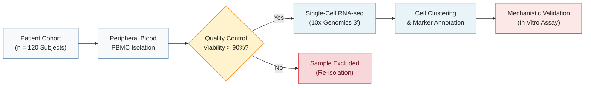
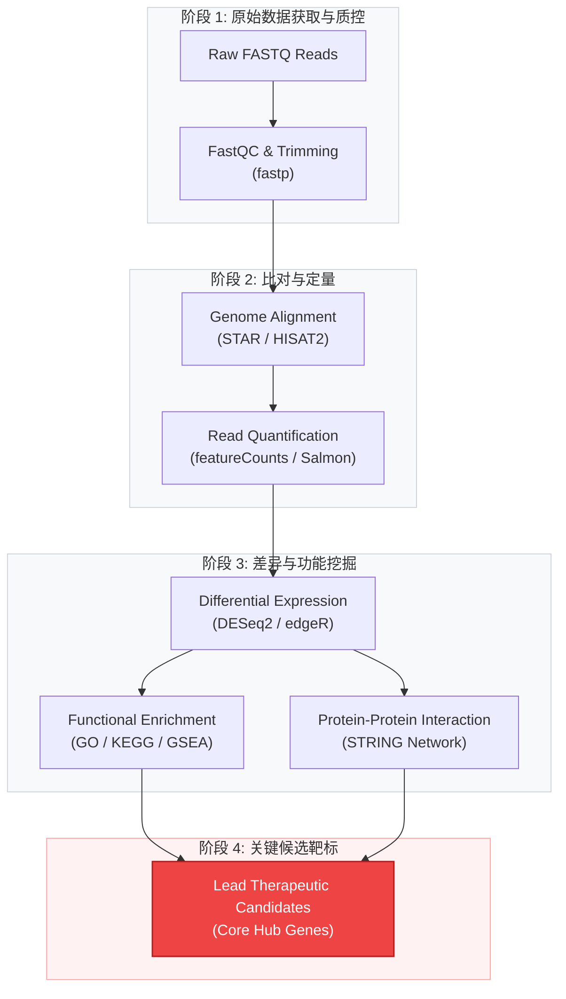
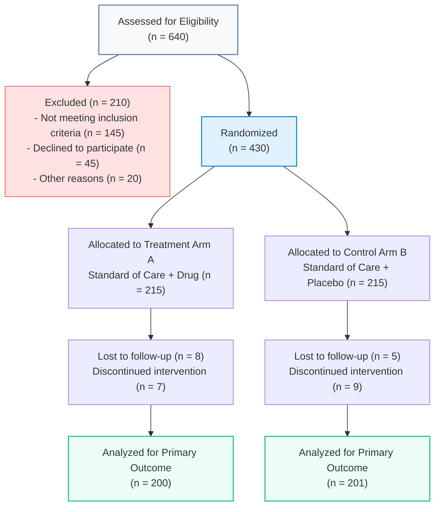
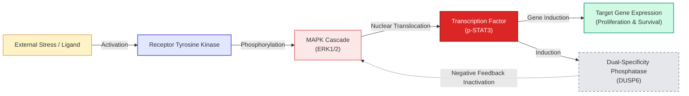

# 轻量级科研流程图 Mermaid 模板库 (Mermaid Diagram Templates)

本模板专为科研草稿、GitHub 文档、Notion 知识库与学术论文 Supplementary Information 设计。支持快速渲染，语法简明，原生兼容 Markdown 预览环境。

---

## 模板 1：临床实验与样本处理标准流水线 (Linear Protocol)

适用于技术路线总览、队列入组与样本处理流：

---

## 模板 2：生物信息学与多组学数据分析管线 (Bioinformatics Pipeline)

适用于生信算法、转录组/突变检测与功能注释分析：

---

## 模板 3：临床研究入组与筛选流程图 (CONSORT Flowchart)

医学顶刊（Lancet, NEJM, JAMA）投稿必备的标准受试者纳入/排除流：

---

## 模板 4：前馈与负反馈调控机制回路 (Feedback Signaling Loop)

适用于展示生物网络中的自抑制环路与稳态调节：

